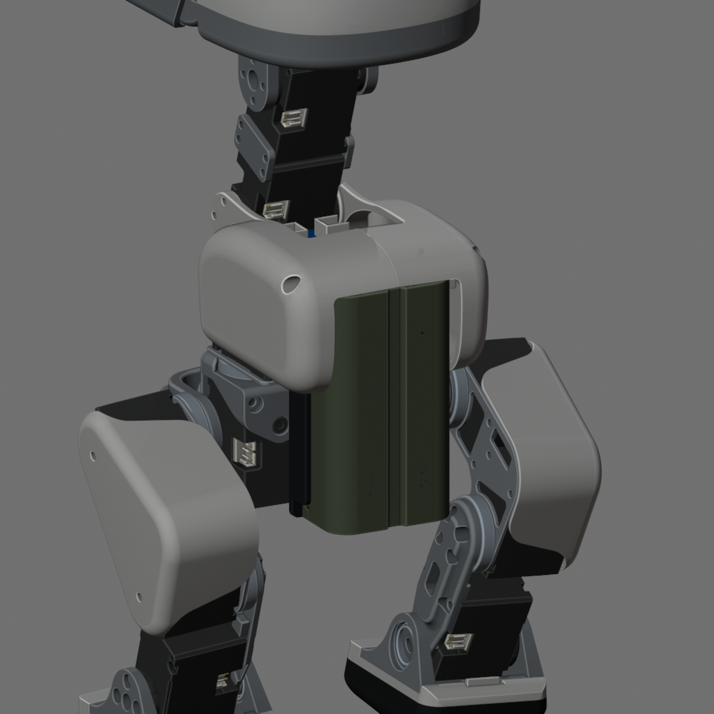

# 铁头 TNP-F550-GN

选用绿色 3500mAh 版，两份 Blender 使用同一电池模型。

[官方说明书](Tilta-NP-F550-manual.pdf) 标明：70.6×38.6×20.5 mm、108 g（均不含保护盖），标称 7.27 V / 3500mAh，额定容量 3300mAh。

外壳按[官方照片](https://tilta.com/shop/tilta-np-f550-battery-3500mah-green/)近似建模，卡槽、卡扣和接触孔沿用原装配尺寸，实物配合待测。电池为外购件。

静态模型与电池仓、取电针无实体重叠；左壳边缘局部重叠约 0.02 mm，卡紧程度待实装确认。详见[检查记录](../../Structure/Verification/battery-update.json)。

[沣标规格书](FB-NP-F550-B.pdf) 仅保留作旧模型来源，不再作为当前选型依据。
