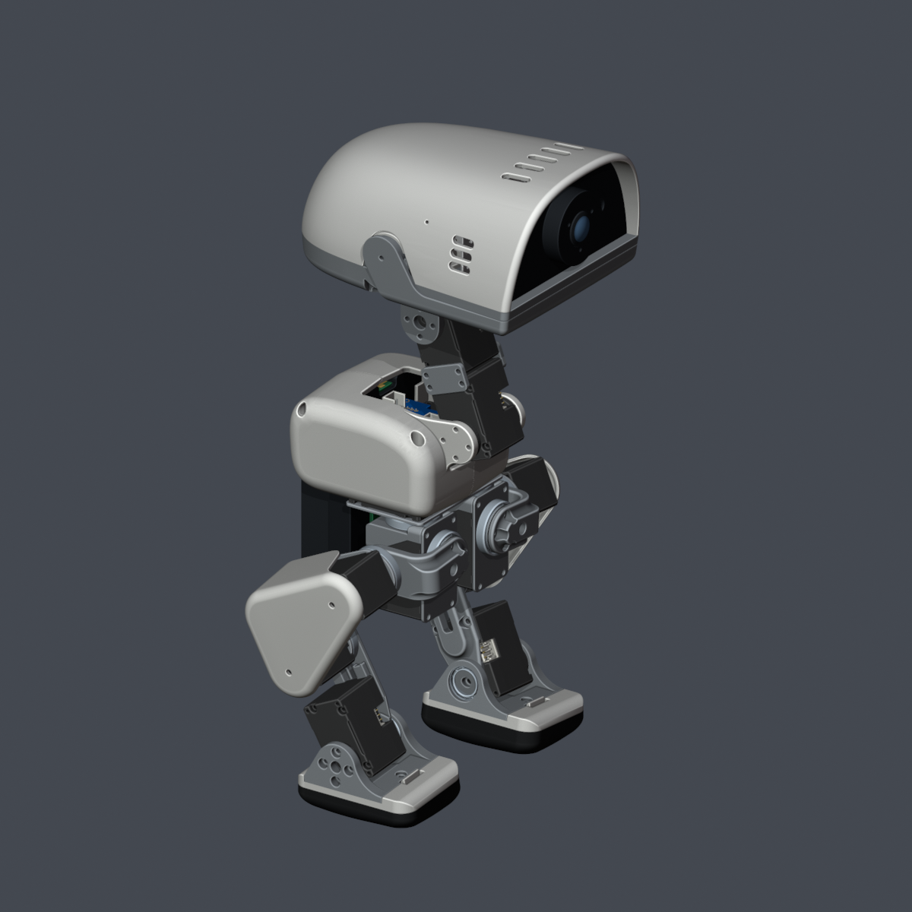

# MicroDuck-Replica

**MicroDuck 个人精修复刻版：让结构模型、板卡、外设与采购清单对应到同一套装配。**

基于 Pollen Robotics 的 MicroDuck 与 kissqy 的飞特 HD1910 复刻方案，整理并修正装配关系、局部几何、外设安装位及打印网格。这里记录本项目实际采用的复刻方案，持续补充实物打样与装配反馈。

| 实际打样配色方案 | 彩色展示方案 |
| --- | --- |
|  |  |

两份 Blender 使用相同的最新几何与装配；图片是模型渲染，颜色未按厂商实物色卡标定。

## 从这里开始

- **打印**：[29 件 STL，按材料和颜色分类](structure/print/STL/)。每件 1 个，单位 mm。11、12、30 号为外购金属件，不在打印包中。
- **查看整机**：[实际打印配色 Blender](structure/blender/MicroDuck-Replica_Print-Colors.blend) · [彩色版 Blender](structure/blender/MicroDuck-Replica_Colorful.blend)。包含舵机、轴承、金属件、五类板卡与外围部件。
- **CAD 参考**：[29 件 STEP](structure/print/STEP/)。其中 13/14 为解析 BRep，其余为网格转换的分面 BRep；当前不作为嘉立创下单文件。
- **做电路板**：[Banana KiCad 与 Gerber](hardware/banana-npf550-pptc/)。HAT、IMU 的源设计和制造参考文件见 [硬件目录](hardware/README.md)。
- **采购**：[完整 BOM](BOM/README.md)，包含整机、29 件打印件和线缆数量。
- **外设资料**：[规格书与安装说明](peripherals/README.md)。

也可在 GitHub **Code → Download ZIP** 下载仓库。Blender 文件约 41 MiB/份，无需 Git LFS；具体大小以文件页为准。

## 内容组织

```text
hardware/       Banana 自制板；HAT、IMU 参考设计；HUB 外购说明
structure/      29 件 STL + STEP、两套完整 Blender、核对记录
peripherals/    已选外设的规格书、尺寸图和安装说明
BOM/            一份 Markdown 整机采购清单
software/       后续软件入口，目前没有软件发布
docs/           修改记录、验证状态、来源和预览
LICENSES/       上游许可与适用范围
```

## 本版主要整理

采用实际打印件装配；修正颈部叉架与腿壳轴端配合，调整头部螺丝柱、Zero 3W 与 HUB 支座位置。头部补入双麦圆形压入座、扬声器背胶平面、IMX219 安装柱；集成板按平面、规则切削和圆角关系重建，并为活动嘴部让位。13/14 号髋部侧摆件和 28/29 号罩壳孔口经过重建与修整，打印网格进一步清理。详见 [修改记录](docs/CHANGES.md)。

## 当前验证状态 · 2026-11-04

**29 件 STL 均有本地网格通过记录；其中 09、22、25、26、28、29、31 号已再次上传嘉立创并通过网格项复检，其余 22 件本轮未重传。** 25、26 号仍有“易变形结构”提示，壁厚保持当前方案。STEP 的平台转换告警未解决，故单列为参考文件。

本仓库还不能等同于整机实物验收完成。相机完整机械资料、外购 HAT/HUB 的具体版本、打印公差、紧固件及运动走线仍需结合实物确认。已完成与待验证项目见 [验证状态](docs/VALIDATION.md)，每个 STL 的哈希与检测结果可在 [结构核对目录](structure/verification/) 查阅。

更新通过 PR 提交，完成 Code Review 后合并；见 [贡献说明](CONTRIBUTING.md)。

## 来源与许可

感谢 [Pollen Robotics / microduck](https://github.com/pollen-robotics/microduck)、[kissqy / Microduck-kissqy](https://github.com/kissqy/Microduck-kissqy) 及社区原作者。Banana 来自 jyg9 社区方案，D1 HAT 来自 Pollen Robotics；本版修改及逐项出处见 [NOTICE](NOTICE.md)。

这是采用 **分项许可** 的公开复刻资料。不同硬件、模型和元件库保留各自原许可，不能将整个仓库视为统一的 MIT/Apache 或无条件商用项目。详见 [LICENSE](LICENSE) 与 [LICENSES](LICENSES/)。
