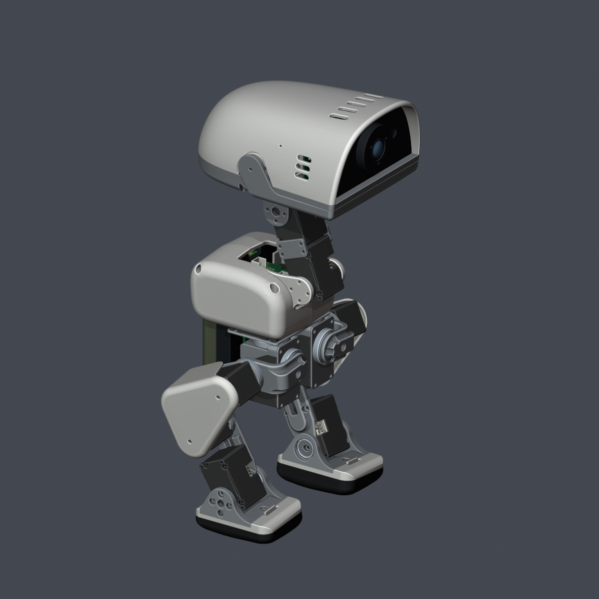
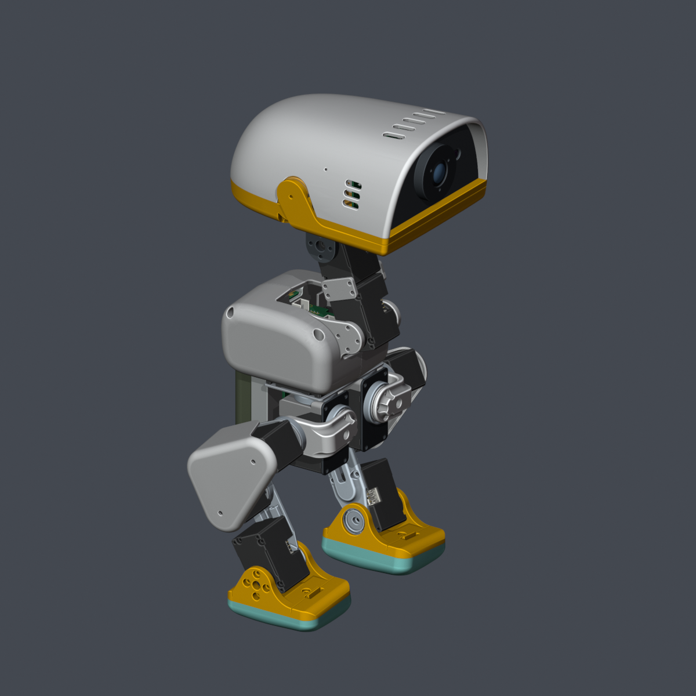

# MicroDuck-Replica

MicroDuck 个人精修复刻版，基于 Pollen Robotics 原版与 kissqy 飞特 HD1910 方案，包含改进后的打印模型、完整装配模型、电路板资料和采购清单。

| 实际打印配色 | 彩色展示 |
| --- | --- |
|  |  |

## 主要改进

- 调整颈部、腿壳和头部的配合，修正板卡安装位置，为活动嘴部留出空间。
- 重建部分零件的曲面、圆角和孔口，清理打印网格。
- 增加双麦克风、扬声器和广角摄像头安装位，补齐电池、板卡及外设的装配模型。

详细尺寸与修改内容见 [修改记录](Docs/CHANGES.md)。

## 项目入口

| 内容 | 入口 |
| --- | --- |
| 采购清单 | [BOM：规格、数量与价格](BOM/README.md) |
| 3D 打印件 | [29 件 STL，每件 1 个](Structure/Print/STL/) |
| CAD 参考 | [29 件 STEP](Structure/Print/STEP/) |
| 整机装配 | [实际打印配色 Blender](Structure/Blender/MicroDuck-Replica_Print-Colors.blend) · [彩色 Blender](Structure/Blender/MicroDuck-Replica_Colorful.blend) |
| 电路板 | [Hardware：KiCad、嘉立创文件和说明](Hardware/README.md) |
| 外设 | [Peripherals：规格书与安装说明](Peripherals/README.md) |
| 软件 | [Software](Software/README.md)，后续补充 |

## 当前状态

物料已下单，正在陆续到货并核对尺寸。23、27 号修订件已重新下单，后续进行整机装配、调试和验证。

文件检查见 [检查记录](Docs/VALIDATION.md)。

## 来源与许可

基于 [Pollen Robotics](https://github.com/pollen-robotics/microduck)、[kissqy](https://github.com/kissqy/Microduck-kissqy) 及社区设计。不同文件按各自原许可使用，详见 [LICENSE](LICENSE)、[NOTICE](NOTICE.md) 和 [LICENSES](LICENSES/)。

修改通过 PR 提交，审核后合并，见 [更新流程](CONTRIBUTING.md)。
