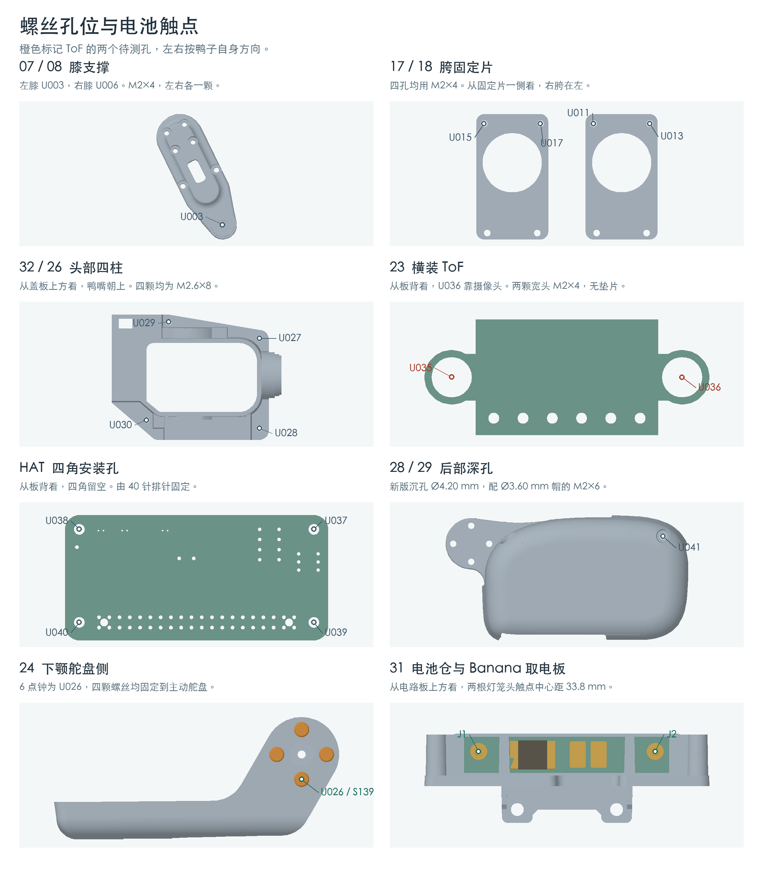

# 装配螺丝孔位复核

原标记的 45 处中，36 处已有螺丝模型，HAT 四角按实装留空。另 5 处为下颚轴承侧光轴和 4 个电池仓旧标记。尺寸单位为 mm，左右按鸭子自身方向。整机每颗螺丝的承压件、接收件和杆端余量见[逐孔核对表](Verification/整机螺丝逐孔核对.md)。

## 安装位置与规格

| 原孔位 | 安装位置 | 规格与数量 | 尺寸依据 |
| --- | --- | --- | --- |
| U003、U006 | 07 左膝支撑 → ID 24、08 右膝支撑 → ID 14，均在脚踝不转动侧 | M2×4，左右各 1 颗（S137、S138） | 按 Ø3.60 螺帽落在 Ø4.20 沉孔底计算，穿过 0.50 厚的支撑后进入舵机轴孔 3.50，距孔底 0.10。螺帽距轴承约 3.19。两只脚踝实装复用舵机原钉，约 1 mm 以内的深入偏差试装可接受 |
| U007、U008 / U009、U010 | 09 左胯外盖上、下轴，10 右胯外盖下、上轴 | M2.5×4 全牙机螺丝，螺距 0.45，4 颗 | 帽下夹厚 1.50，进入从动轴 2.50，距模型孔段末端 1.10。模型头径 4.5、头高 1.6 |
| U011、U013 / U015、U017 | 17、18 胯固定片上排（靠躯干），左侧拧入 15，右侧拧入 16 | M2×4 平尾自攻，4 颗 | 每侧两孔，孔距 18.00。固定片过孔 Ø2.20。15、16 号打印件的原底孔 Ø2.05，v3.8 改为 Ø1.75，入口导向深 0.35。4 mm 杆进入打印件约 2.80，其中 2.45 在 Ø1.75 段内。杆端距后方轴承约 1.03。树脂件咬合力待试装 |
| U026 | 24 下颚左侧 6 点钟孔 → ID 34 主动舵盘 | M2×6，1 颗（S139） | 帽底至舵盘约 3.74，杆端伸入 2.26，距舵机壳 0.74。牙型配舵盘 |
| U027–U030 | 32 盖板 → 26 头部底座四柱，依次为右前、右后、左前、左后 | M2.6×8 平尾自攻，4 颗 | 盖孔 Ø2.70。26 号柱口增加 0.65 深的锥形导向，下方底孔 Ø2.20。按 8 mm 杆计算，四颗均进入直孔约 4.55。右前、右后、左后距盲孔底 4.10。左前 U029 通向斜面，沿孔壁距出口近侧 0.73、远侧 4.01。起牙手感待试装 |
| U033、U034 | 31 号电池仓上方，HUB 后排右、左两孔 | 固万基 304 十字圆头平尾自攻 M2×12，2 颗 | 十字螺丝头在板上。由上向下穿过 HUB 和 31 号电池仓打印支耳，右孔拧入 ID 10、左孔拧入 ID 20 的舵机外围安装孔。模型中帽底距耳孔入口约 6.86，耳厚约 4.50，按 12 mm 杆长计算，末端露出约 0.64 |
| U041 | 28 左壳后部深孔 → 29 右壳 | M2×6 平尾自攻，1 颗 | v3.9 容帽段 Ø4.20，采购款 Ø3.60 螺帽单边余 0.30。台阶后的过孔 Ø2.20，杆端伸入右壳 3.70，距孔段末端 1.00。已打印的旧版可配帽径约 3.20 的小头 M2×6。[孔底剖面](../Docs/Images/rear-shell-screw-seat.png) |

17、18 号固定片的**下排**靠脚，每侧两孔，孔距 16.00。S053–S056 穿过固定片，直接拧入左侧 ID 21、右侧 ID 11 的舵机壳。按模型中的 M2×4 计算，螺杆进入舵机约 3.00，至孔段末端余约 0.50。牙型按舵机配套螺丝选。[上下排装配剖面](../Docs/Images/hip-plate-screw-rows.png)

09、10 号的牙型取自厂家 STEP 中与从动轴配套的中心螺丝，实测模型牙顶 Ø2.50、同侧齿面轴向间距 0.45。杆长按本版外盖的厚度选择。[飞特 HD-1910-C001 机械资料](https://ftservo.github.io/ftservo-wiki/products/models/hd-1910-c001/main/)

HUB 后排螺丝的商品图标注杆长 12 mm、帽径约 3.6 mm、帽高约 1.4 mm。[采购清单](../BOM/README.md)

### 舵机壳体角孔

这 16 个 HD-1910 壳体角孔与舵盘外圈安装孔使用同牙型 M2 螺丝。在模型中，角孔以 Ø1.6 mm 底孔表示。下表按夹持厚度和孔深列出各处杆长。

| 原孔位 | 安装位置 | 杆径 × 杆长 | 进入舵机孔段 / 剩余孔段 |
| --- | --- | --- | --- |
| U001、U002 / U004、U005 | 07 左膝上、下孔，08 右膝下、上孔 → 舵机 24、14 | M2×5，4 颗 | 2.70 / 1.80 |
| U012、U014 / U016、U018 | 15 左胯内、外沉孔，16 右胯外、内沉孔 → 舵机 21、11 | M2×4，4 颗 | 3.20 / 1.30 |
| U019、U020 / U021、U022 | 20 号右颈板，分别固定舵机 31 和 30，每组依次为前、后孔 | M2×5，4 颗 | 3.00 / 1.50 |
| U023、U024 | 22 号头部侧倾架的前、后孔 → 舵机 32 | M2×6，2 颗 | 3.00 / 1.50 |
| U031、U032 | 28 左壳、29 右壳的安装耳 → 舵机 20、10 | M2×5，2 颗 | 3.00 / 1.50 |

实装时可按图找到 HUB 后排、颈部和腿部的螺丝，再用图上的 U、S 编号查表。[装配位置对照图](../Docs/Images/assembly-screw-guide.png)

## 孔位图与 ToF 试装

| 孔位 | 规格与模型尺寸 | 实物核对 |
| --- | --- | --- |
| **U035、U036** · 23 号脸板 ToF 两个安装耳 | 宽头 M2×4，两颗，无垫片。板厚 1.6，过孔约 Ø3.5，孔距 20。柱高 2.50，底孔 Ø1.75，孔深 2.70，孔底厚 1.10 | 螺杆入柱 2.40，杆端留 0.30。按 Ø4.50 承压面居中计算，每侧压住 0.50 孔边。新版锁紧手感待试装。[剖面](../Docs/Images/tof-camera-mount.png) |

HAT 与 ZERO 3W 由 2×20 排针固定，U037–U040 四角留空。下层 ZERO 3W 通过 S102–S105 固定在 23 号脸板上。

小孔用量针或钻头的光滑柄端轻插，记录能通过的最大直径。小于孔口的细钝杆可用于量深，起点取表中指定的承面或柱顶。

在 Blender 大纲搜索 U 编号可定位孔位，U035、U036 分别对应螺丝实体 S140、S141。

## 下颚和电池触点

- **24 号下颚**左侧主动舵盘四孔都装螺丝。右侧 U025 光轴压入轴承内圈，中心留空。
- **31 号电池仓**的两根 U6068 灯笼头取电针穿过仓体，分别焊在 Banana 板 J1、J2，孔中心距 33.8 mm。旧图的 U042／U044 和 U043／U045 标在中心距 19.0 mm 的下耳两孔，这两组标记已撤下。[Banana 板焊接说明](../Hardware/Banana-NP-F550/README.md)
