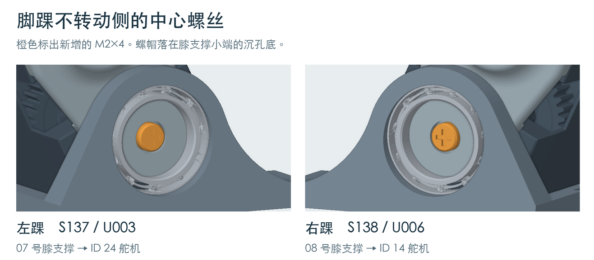
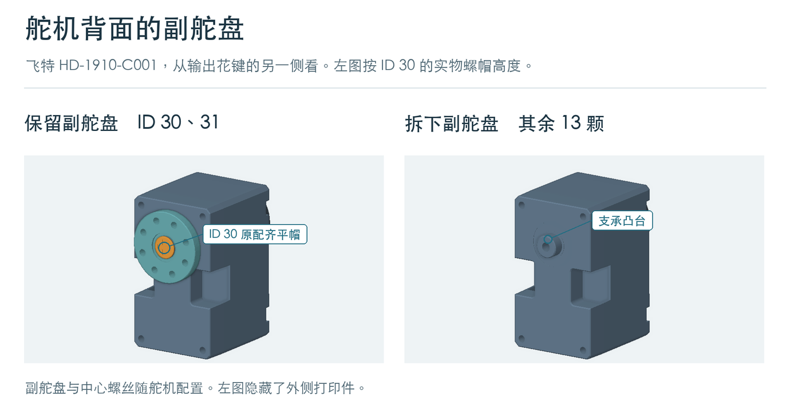

# 实物装配记录

## 01 · 07 左膝支撑、08 右膝支撑的轴承配合凸台

两个膝支撑下方与轴承配合的凸台端面都是斜的。较高的一侧挡住了下方零件，导致它套不到位。

这次装配用砂纸磨低凸台较高的一侧，端面磨平一些后，下方零件就能卡到位。

原斜面高低相差约 2 mm，第一版修订把端面削平。v3.10 沿轴线再削低 0.15 mm，左右两侧的凸台均从 0.99 mm 降到 0.84 mm，外径 Ø10 mm。模型中凸台伸入轴承内圈约 0.64 mm，其中约 0.44 mm 与内圈直段配合。中心仍用 M2×4。新版待试装。[凸台剖面](../Docs/Images/ankle-bearing-step.png)

## 02 · 下颚右侧光轴偏松、轴承容易向头内移动

左侧四颗螺丝把 24 号下颚固定在 ID 34 主动舵盘上，6 点钟位置为 U026（S139）。右侧 U025 是光轴，插入 6700 轴承内圈，中心留空。

- **光轴与内圈**。旧件实装在光轴上绕一圈绝缘胶带，增大轴径后便能卡住内圈。修订件的配合段已从 Ø10.00 增至 Ø10.20 mm，轴端有 0.25 mm 导入段，试装时先用裸轴检查松紧和转动。
- **轴承与座孔**。旧件实装时，整颗轴承可以被推进头部。32 号上盖和 26 号底座各承托一段 6700 轴承的外圈，两件配套使用。轴承尺寸为内径 10 mm、外径 15 mm、宽 3 mm。

32 号上盖与 26 号底座分别沿原轴承座的前后平面向孔内延伸，左右端与旁边台阶一刀平切。上挡肩厚 1.00 mm，下挡肩厚 1.02 mm，沿轴承轴线量。模型中轴承外圈向头内移动 0.20 mm 后接触挡肩。[四个平切端头](../Docs/Images/jaw-stop-ends-v3-16.png) · [轴承剖面](../Docs/Images/jaw-bearing-stop.png)

下颚从闭合到张开 30°，每 0.25° 核对一次，与挡肩的最小采样间隙为 1.90 mm。打印后需确认外圈能被挡住、下颚能顺畅开合。[轴承安装方向](../Docs/Images/jaw-bearing-stop-guide.png)

## 03 · 脸板、眼圈与摄像头

第一版实装时，镜头最高点略高于眼圈，实拍画面边缘没有被遮挡。固定 27 号眼圈的三颗螺丝靠近摄像头的四根安装柱，操作空间偏紧。摄像头 PCB 的四孔与柱孔对位略有偏差，锁紧眼圈时脸板会轻微变形。

v3.12 沿用首版 8 mm 眼圈。23 号背面的四根相机柱从首版 6.0 mm 加高到 7.6 mm，镜头沿光轴向头内退 1.6 mm。模型中黑色镜筒前沿低于眼圈 4.00 mm，参考玻璃顶点低于眼圈 2.16 mm。玻璃凸起和新版画面边缘待实物确认。

v3.14 将眼圈三孔从上面一颗、下面两颗改为上面两颗、下面一颗。23 号通孔与 27 号盲孔成对移动，配套使用同版零件。相机四柱孔距为 21 × 13.5 mm。[新旧孔位对照](../Docs/Images/eye-ring-fasteners-v3-14.png)

| 最近处（mm） | 旧版 | v3.14 |
| --- | ---: | ---: |
| 23 号螺孔边到镜头开口 | 0.55 | 2.66 |
| 眼圈螺帽到相机柱外壁 | 1.99 | 2.66 |
| 眼圈螺丝到相邻 ToF 螺丝 | 2.09 | 3.53 |
| 两颗眼圈螺帽之间 | 11.99 | 14.80 |

先把眼圈贴到脸板正面，两个孔朝上。从脸板背面用三颗 M2×4 穿过 Ø2.40 mm 通孔，拧进眼圈背面的盲孔，再装摄像头和板卡。模型中每颗螺丝拧入约 1.95 mm，距孔底约 3.05 mm。新版面板锁紧后的平整度与实际对孔待试装。

## 04 · 26 号头部底座后侧的螺钉头孔口偏小

装后脑勺这颗固定螺丝时，螺钉头卡在底座后侧的孔口。将孔口稍微磨大后，螺钉头才放得进去。

修订后，后脑沉孔名义直径由 4.20 增至 4.70 mm，保留原孔深及通孔。按 Ø4.0 mm 螺帽，单边余量约 0.35 mm。

## 05 · 黑色 TPU 脚底容易脱落

01、02 号 TPU 95A 脚底与硬脚掌扣合偏松，偶尔脱落。旧件实装在配合台阶上绕一圈绝缘胶带，增加夹紧力。

左脚 01 配 03，右脚 02 配 04。v3.13 将 TPU 内侧两条直边和边上的圆头卡筋各向内收 0.125 mm，两边之间的净宽由 36.80 mm 减至 36.55 mm。若已有带卡槽的 03、04 号硬脚掌，只需更换 TPU 脚底。试装先取下台阶上的胶带，检查四条卡筋是否入槽，以及走动后脚跟和脚尖是否仍会翘起。

## 06 · ToF 装上前罩后测距不准

本机的 VL53L5CX 模块装上随附的黑色前罩后，距离读数不准。实物已取下前罩，完整模型也按裸板装配。

第一版实装使用两颗 M2×5，无垫片。安装耳实测厚 1.6 mm，板孔约 Ø3.5 mm。

v3.11 裸板支座由 3.0 mm 降到 2.5 mm，模块朝脸板前移 0.5 mm。两颗宽头 M2×4 直接压板，螺杆伸入 2.40 mm，距孔底 0.30 mm。焊盘下方增开 0.80 mm 深的避让槽，前窗外缘单侧放宽 0.60 mm。[安装剖面](../Docs/Images/tof-camera-mount.png)

## 07 · 舵机连接线的实际用量

大部分舵机之间用随舵机附赠的 8 cm 线连接。三根芯线并排连在一起，实装时线身强度够用。

外购的 10 cm 线共用 4 根，每段 1 根。左腿接舵机 ID 21–22、23–24，右腿接 ID 11–12、13–14。舵机之间没有用到 20 cm 线。

## 08 · 舵机背面的副舵盘

按舵机 ID 装配。颈部的 **30、31 保留副舵盘**，其余 13 颗拆下副舵盘。拆盘后露出约 2.5 mm 高的支承凸台，胯外盖和脚踝的中心螺丝按下表安装。15 颗舵机输出花键一侧的主动盘都要保留。

| 舵机 ID | 安装位置 | 副舵盘 | 配合部件 |
| --- | --- | --- | --- |
| 30 | 颈部俯仰 | 保留 | 28 号左壳有四颗螺丝拧入副盘。实物原配中心螺帽不高于副盘端面。模型按齐平上限复核，帽边距 28 号壳孔边约 0.16 mm |
| 31 | 头部俯仰 | 保留 | 21 号头部旋转架有四颗螺丝拧入副盘 |
| 10、20 | 右、左髋转向 | 拆下 | 10 的盘缘碰 29 号右壳，20 的盘缘碰 28 号左壳 |
| 11、21 | 右、左髋侧摆 | 拆下 | 11 的盘面碰 16 号右胯旋转件，21 的盘面碰 15 号左胯旋转件 |
| 12、13、22、23 | 两侧髋俯仰、膝关节 | 拆下 | 盘缘与 09、10 号胯外盖干涉。两块外盖的上、下轴各用一颗 M2.5×4（S110–S113） |
| 14、24 | 右、左踝 | 拆下 | 副盘占用 08、07 号膝支撑小端的位置。两侧小端中央各装一颗 M2×4 |
| 32 | 头部转向 | 拆下 | 副盘与 22 号头部侧倾架重叠 |
| 33 | 头部侧摆 | 拆下 | 副盘和中心螺帽都碰 25 号头盖及 26 号底座 |
| 34 | 嘴部开合 | 拆下 | 头摆正时盘缘有约 1.5 mm 空间。头向一侧倾约 8° 就碰 22 号侧倾架，反方向约 15° 会碰 ID 32 舵机壳 |

ID 10、11、20、21、32、33、34 拆盘后，裸轴的模型孔深约 3.60 mm。直接装 4 mm 螺丝时，帽底距轴端还有约 0.40 mm，杆端就会顶到孔底。

这些间隙和角度来自当前装配模型。XGO 手册将 10、20、32 列为可选拆卸，本版这三处即使转动副盘调整孔位，盘缘仍会碰到躯壳或头架。[XGO 装配手册第 2 页](https://github.com/LuwuDynamics/xgoduck_hardware/blob/e62467ac8aa7ccac763555c61a554d9c32de5f35/Assembly_Guide.pdf#page=2)

## 09 · ZERO 3W 散热片固定与 HAT 背面绝缘

瑞莎 5519A 纯铜散热片装在 ZERO 3W 芯片一侧，位于主板和 HAT 之间。实装时散热片单靠粘贴容易松动，用线绕主板和散热片一圈固定，防止调试中跌落时脱开。HAT 背面朝向铜片的一侧贴一层绝缘胶带。

完整模型按官方 55 × 19 × 2 mm 外形建模。导热垫压紧厚度暂按 1.10 mm，散热片顶面到 HAT 最近焊脚的模型间隙约 3.60 mm。绕线处的实际间隙和导热垫厚度待实测。[瑞莎 5519A 规格](https://radxa.com/products/accessories/heatsink-5519a/#techspec)

## 螺丝位置

在 Blender 的“装配螺丝”集合选中螺丝，可从名称读取编号和规格。对象属性标明螺帽压在哪个零件上、螺杆拧入哪一件，以及杆端距孔底或后方零件的距离。规格中的长度从螺帽底面量到杆端。表中列出实装规格及按模型选取的杆长。

| 安装位置 | 数量 | 螺丝 | 装配说明 |
| --- | ---: | --- | --- |
| 07、08 膝支撑靠脚踝的小端中心 | 2 | M2×4 | 左 S137（U003）拧入 ID 24，右 S138（U006）拧入 ID 14。实装复用舵机不转动侧的原钉。这两孔约 1 mm 以内的深入偏差试装可接受 |
| 17、18 号胯固定片上排（靠躯干，孔距 18 mm） | 4 | M2×4 平尾自攻 | 左右各两颗，穿过固定片后拧入 15、16 号胯旋转打印件约 2.8 mm。v3.8 的 Ø1.75 mm 底孔在这两个打印件上，锁紧手感待试装 |
| 17、18 号胯固定片下排（靠脚，孔距 16 mm） | 4 | M2，模型用 4 mm 杆长，牙型随舵机 | 左右各两颗，穿过固定片后直接拧入舵机壳约 3.0 mm。左腿为 ID 21，右腿为 ID 11 |
| 22 号侧倾架固定到 ID 33 主动舵盘 | 4 | M2×6，牙型配舵盘 | 螺杆伸入舵盘约 1.10 mm，杆端距舵机壳约 1.90 mm。锁紧力待试装 |
| 23 号脸板固定 27 号眼圈 | 3 | M2×4 平尾自攻 | 从脸板内侧穿入，进入眼圈约 1.95 mm，距盲孔底约 3.05 mm |
| 摄像头 PCB 固定到 23 号四柱 | 4 | M2×5 平尾自攻 | 穿过 1.6 mm PCB 后进入柱孔约 3.4 mm，四孔先对齐再交替收紧 |
| 24 号下颚固定到 ID 34 主动舵盘 | 4 | M2×6，牙型配舵盘 | 四颗螺丝压在略斜的承面上，帽底两边约差 0.24 mm，实装可接受。6 点钟的 S139 伸入舵盘约 2.26 mm |
| 26 号底座固定 25 号头盖，两侧 | 2 | M2.6×8 平尾自攻 | S009、S010 各一颗。穿过底座后拧入头盖约 2.98 mm，其中直孔段约 2.18 mm |
| 26 号底座固定 25 号头盖，后脑 | 1 | M2.5×16 尖尾自攻 | 固万基商品图标注帽径约 4.0 mm、帽高约 1.4 mm。进入小径孔段约 5.0 mm，包含尖端 |
| 28 左壳至 29 右壳后部深孔 | 1 | M2×6 平尾自攻，帽径约 3.60 mm | 旧件的孔壁越往里越窄，螺帽难以落座。v3.9 将容帽段放宽至 Ø4.20 mm，螺杆进入右壳约 3.70 mm。[新旧剖面](../Docs/Images/rear-shell-screw-seat.png) |
| IMU 板固定到 31 号电池仓 | 4 | M2×6 | 螺帽直接压板，板下有 2 mm 隔离垫。6 mm 杆进入仓体约 2.44 mm，距电池壳约 1.75 mm。换用 8 mm 时，杆端会与电池壳重叠约 0.25 mm。[两种杆长剖面](../Docs/Images/imu-screw-battery-clearance.png) |
| HUB 后排穿过 31 号电池仓 | 2 | 固万基 304 十字圆头平尾自攻 M2×12 | 十字头在 PCB 上方。穿过 31 号打印支耳，右孔拧入 ID 10、左孔拧入 ID 20 的舵机外围安装孔 |
| 32 号盖板固定到 26 号中央四柱 | 4 | M2.6×8 平尾自攻 | 旧件上的螺丝能穿过盖板，在柱口起牙偏紧。v3.8 把 26 号四个柱口内的平阶改成 0.65 mm 深的斜面，下方直孔 Ø2.20 mm。8 mm 杆进入直孔约 4.55 mm。左前 U029 通向斜面，另外三孔是盲孔。[孔口剖面](../Docs/Images/head-post-lead-in.png) |
| 23 号脸板固定横装 ToF | 2 | M2×4 宽头平尾自攻，无垫片 | U035、U036，帽底承压直径约 Ø4.5 mm。2.70 mm 深的柱孔留 0.30 mm 余量 |

“装配螺丝”集合收录 141 颗。ID 30、31 的两颗原配副舵盘中心螺丝随舵机单列。HAT 靠 ZERO 3W 上的 2×20 排针固定，HAT 四角留空。16 个舵机壳体角孔与舵盘外圈使用同牙型 M2。按各处夹持厚度选用 M2×4 共 4 颗、M2×5 共 10 颗、M2×6 共 2 颗。[整机逐孔核对表](Verification/整机螺丝逐孔核对.md)

[胯固定片上下两排孔的装配剖面](../Docs/Images/hip-plate-screw-rows.png)

新增规格、孔位图和量法见[螺丝孔位复核](螺丝孔位复核.md)。
